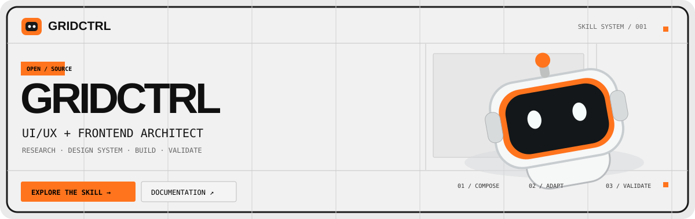
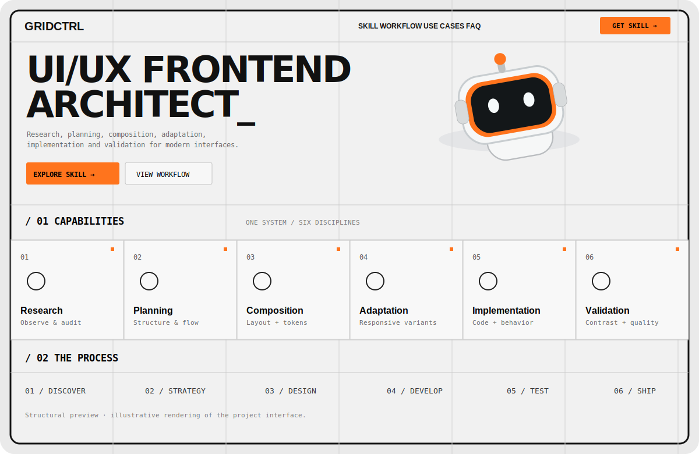
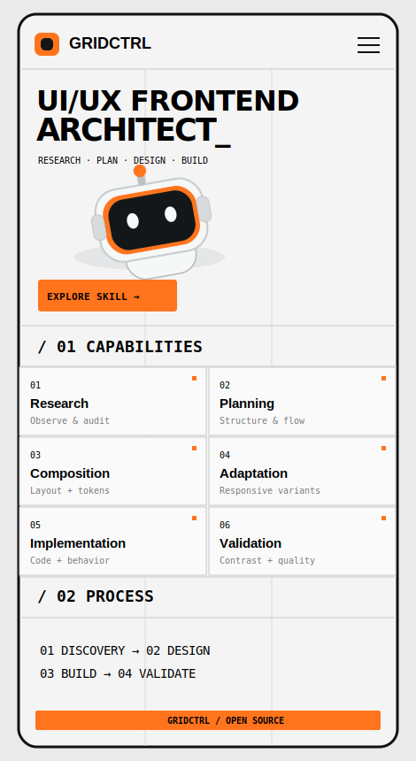

<div align="center">



# GRIDCTRL

**UI/UX Design Intelligence · Frontend Architecture · AI Agent Skill**

*Transforme referências visuais em interfaces implementáveis, consistentes e verificáveis.*

[](LICENSE)
[](skill/SKILL.md)
[](index.html)
[](skill/assets/variants.json)

[Landing page](index.html) · [Instalar Skill](#-instalação-da-skill) · [Documentação](docs/AGENT-INTEGRATION.md) · [Exemplos de uso](examples/prompts.md) · [Contribuir](CONTRIBUTING.md)

</div>

---

## ◈ Visão geral

**GRIDCTRL** é um projeto open source que reúne uma **Skill para agentes de IA** e uma **landing page demonstrativa**. Seu propósito é orientar pesquisa, planejamento, engenharia reversa visual, design systems, implementação frontend e validação — evitando resultados genéricos e alterações que quebrem aplicações reais.

A direção visual nasce do **Swiss Grid / Technical Minimalism / Retro-futurism**: linhas ortogonais, tipografia expressiva, módulos editoriais, superfícies claras, elementos robóticos e cores de acento utilizadas com disciplina.

> **Duas camadas independentes:** a Skill `skill/SKILL.md` fornece instruções a agentes compatíveis; o pacote JavaScript `@tersanplay/gridctrl` implementa tokens, geração de artefatos, validação e CLI. O pacote é **instalável pelo código-fonte/GitHub**, ainda não declarado como publicado no registro npm.

## ◈ Ferramentas executáveis (novo)

O projeto agora fornece **código real e testável**, além das instruções da Skill. Requer **Node.js 22+** para o import JSON nativo.

```bash
git clone https://github.com/TersanPlay/GRIDCTRL.git
cd GRIDCTRL
npm install
npm run check               # Valida seis paletas e contraste
npm test                    # Testes de tokens e CLI
npm run build               # CSS + JSON DTCG + Sass
node src/cli/index.js themes
node src/cli/index.js init --target ./projeto-demo --variant mint-lab
```

A CLI também oferece `build --out <pasta>`, `validate --json` e `validate --config <arquivo>`. O `init` não sobrescreve arquivos existentes sem `--force`.

**Artefatos gerados:** `dist/gridctrl.css`, `dist/gridctrl.tokens.json`, `dist/_gridctrl.scss` e `dist/gridctrl.variants.json`. A definição canônica das seis variantes permanece em [`skill/assets/variants.json`](skill/assets/variants.json).

**Integrações executáveis:** [React + componentes locais no padrão shadcn/ui e Radix](examples/react-shadcn/README.md) · [Vue 3](examples/vue/README.md). Para executar o React ou Vue: rode primeiro `npm run build` na raiz, depois `npm install && npm run dev` na pasta do exemplo. Os componentes React do exemplo **não são apresentados como código gerado pelo CLI oficial do shadcn**; usam o modelo copy-to-project com Radix.

**Documentação central:** [Arquitetura e fonte de verdade](docs/ARCHITECTURE.md) · [Tokens e build](docs/TOKENS.md) · [Qualidade e testes](docs/QUALITY.md).

## ◈ Demonstração visual

<table>
  <tr>
    <th align="left">Desktop · composição modular</th>
    <th align="left">Mobile · reflow responsivo</th>
  </tr>
  <tr>
    <td width="70%" valign="top"></td>
    <td width="30%" valign="top"></td>
  </tr>
</table>

*Imagens acima são **composições vetoriais ilustrativas**, não screenshots automatizados da execução. Para experimentar a interface real, abra [`index.html`](index.html).*

### Explore as paletas ao vivo

O **Theme Lab** da landing page permite selecionar uma paleta e observar a alteração imediatamente. A preferência fica salva localmente no navegador, sem sorteio de layout ou mudança inesperada de componentes.

| Preset estável | Direção | Cor de destaque |
| --- | --- | --- |
| `industrial` | Grafite / Laranja · padrão GRIDCTRL | `#FF741D` |
| `soft-pastel` | Pêssego / Blush | `#E9AA91` |
| `warm-editorial` | Areia / Terracota | `#E98241` |
| `mint-lab` | Cinza original com mescla sálvia + cinza-azulado; CTA verde | `#83CBA8` |
| `lilac-lab` | Cinza original com mescla lavanda + cinza-ardósia; CTA lilás | `#B7A1E2` |
| `midnight` | Grafite escuro / Elétrico | `#FF8746` |

As variações são **determinísticas**: alteram cores artísticas e superfícies, sem reorganizar aleatoriamente a interface. Nos temas **Mint / Forest** e **Lilac / Iris**, o background permanece branco/cinza-claro como na skin original; duas tonalidades levemente coloridas e próximas do cinza se mesclam em um gradiente sutil, enquanto o verde e o lilás permanecem nos CTAs. Os valores são propostas de design; contrastes devem ser verificados no contexto final.

## ◈ Funcionalidades e princípios

| Área | O que a Skill exige |
| --- | --- |
| **Variações controladas** | `variantId` explícito, composição estável, sem `Math.random()` no render. |
| **Arte × funcionalidade** | Decoração nunca cobre textos, foco, formulários ou ações. |
| **Cores semânticas** | Tokens próprios para texto, interação, foco, erro, aviso e sucesso, inclusive nos temas pastel. |
| **Performance** | CSS/SVG primeiro; engines 3D somente com justificativa, fallback e testes. |
| **Auditoria prévia** | Inspecionar arquitetura, componentes, rotas, dependências e regras de negócio antes de modificar sistemas existentes. |
| **Qualidade visual** | Comparar grid, hierarquia, proporções, tipografia, responsividade e estados; rejeitar maquiagem genérica. |
| **Componentes de UI** | Em React, preferir **shadcn/ui** quando adequado. **Não sugerir componentes nativos sem estilização** como interface final. |

**Semântica HTML continua obrigatória.** A regra sobre componentes nativos se refere a controles crus do navegador, não à proibição de `<button>`, `<input>`, `<label>` ou outros elementos semânticos usados internamente por bibliotecas acessíveis.

## ◈ Instalação da Skill

### 1. Clonar o repositório

```bash
git clone https://github.com/TersanPlay/GRIDCTRL.git
cd GRIDCTRL
```

### 2. Copiar a pasta da Skill para o seu projeto

**Agentes compatíveis com diretórios de Skills** podem reconhecer a pasta `SKILL.md` conforme suas próprias convenções. Exemplo de instalação local por projeto:

```bash
# Execute dentro do seu projeto de destino:
mkdir -p .agents/skills/gridctrl-ui-ux-frontend
cp -R /caminho/para/GRIDCTRL/skill/. .agents/skills/gridctrl-ui-ux-frontend/
```

Para ferramentas que adotam outro diretório, utilize o caminho indicado na documentação correspondente. Por exemplo, no **Claude Code**, a pasta de projeto pode ser:

```text
.claude/skills/gridctrl-ui-ux-frontend/SKILL.md
```

**Windows / PowerShell**, a partir do diretório deste repositório:

```powershell
New-Item -ItemType Directory -Force -Path ".agents/skills/gridctrl-ui-ux-frontend" | Out-Null
Copy-Item -Path "skill/*" -Destination ".agents/skills/gridctrl-ui-ux-frontend" -Recurse -Force
```

> Os caminhos são exemplos, não uma promessa de carregamento automático em todo agente. Se sua ferramenta não suportar Skills locais, forneça os arquivos `skill/SKILL.md`, `skill/references/` e `skill/assets/` como contexto. Mais informações em [Integração com agentes](docs/AGENT-INTEGRATION.md).

### 3. Acionar a Skill

Use um comando explícito:

```text
Use a Skill GRIDCTRL para auditar meu frontend antes de alterar código.
Preserve rotas, autenticação, regras de negócio e componentes existentes.
Selecione o preset "industrial" e o layout estável "dashboard-v1".
Planeje as modificações e implemente somente após identificar riscos.
Utilize shadcn/ui caso o projeto seja React e a dependência seja adequada.
Entregue os testes executados, a comparação visual e as limitações.
```

### 4. Abrir a landing page

**Não é necessária instalação de dependências frontend.** O arquivo `index.html` é autônomo, com CSS, JS e imagens incorporados.

```bash
# Na raiz do repositório
python -m http.server 8000
```

Acesse `http://localhost:8000` ou abra `index.html` diretamente. O repositório **não está automaticamente publicado como site hospedado** apenas por conter a landing page.

## ◈ Modos de operação

| Modo | Papel do agente | Entrega |
| --- | --- | --- |
| `DISCOVER` | Pesquisa e curadoria | Referências, usuários e critérios |
| `DECONSTRUCT` | Engenharia reversa visual | Grid, tokens, componentes e evidências |
| `PLAN` | Planejamento de UX | Arquitetura, fluxos, estados, plano técnico |
| `ADAPT` | Adaptação consciente | Estética integrada às necessidades do produto |
| `BUILD` | Implementação frontend | Código funcional, responsivo e acessível |
| `AUDIT` | Auditoria de aplicações | Inventário, riscos e plano incremental |
| `VALIDATE` | Controle de qualidade | Testes, fidelidade, performance e pendências |

**Novo projeto:** `DISCOVER → DECONSTRUCT → PLAN → BUILD → VALIDATE`

**Projeto existente:** `AUDIT → PLAN → BUILD → VALIDATE`

## ◈ Design system e opções técnicas

O conjunto de assets em `skill/assets/` possui design tokens e [presets versionados](skill/assets/variants.json). A camada artística (canvas, superfície, acento, ornamentos) é separada da camada funcional (texto, foco, erro, alerta, sucesso).

```json
{
  "variantId": "soft-pastel",
  "stableId": "portal-v1",
  "allowRandomLayout": false
}
```

### Componentes shadcn/ui

Quando a Skill for utilizada em **React ou Next.js**, ela deve privilegiar **shadcn/ui** quando tecnicamente adequado, com componentes como Button, Card, Dialog, Accordion, Tabs, Select, Switch, Badge e Popover. Em outras stacks, deve usar alternativas acessíveis equivalentes e estilizadas, sem migrar a arquitetura arbitrariamente.

A landing page estática inclui um **showcase inspirado visualmente em shadcn/ui**. Não afirma utilizar o pacote React em runtime.

Leia [Componentes e shadcn/ui](skill/references/componentes-e-shadcn.md), [Qualidade e critérios de aceite](skill/references/quality-gates.md) e a [documentação oficial](https://ui.shadcn.com/).

## ◈ Estrutura do repositório

```text
GRIDCTRL/
├── package.json                  # Package JS, CLI e exports
├── src/
│   ├── core/                     # Tokens, presets, contraste, CSS/DTCG/Sass
│   ├── cli/                      # gridctrl themes/validate/build/init
│   └── react/                    # GridctrlProvider e useGridctrl
├── skill/
│   ├── SKILL.md                  # Instruções normativas para agentes
│   ├── assets/variants.json      # ÚNICA fonte de dados dos temas
│   ├── assets/variants.schema.json
│   └── references/              # Guias de auditoria e qualidade
├── examples/
│   ├── react-shadcn/             # Componentes e Radix com Vite
│   ├── vue/                      # Exemplo Vue 3
│   └── prompts.md
├── tests/
│   ├── unit/                     # Node test runner
│   └── e2e/                      # Playwright e axe
├── docs/
│   ├── ARCHITECTURE.md
│   ├── TOKENS.md
│   ├── QUALITY.md
│   └── AGENT-INTEGRATION.md
├── .github/workflows/ci.yml
├── index.html                    # Landing original, autônoma
└── README.md
```

**Fonte única de verdade para as paletas:** `skill/assets/variants.json`. `dist/` é gerado por compilação; os arquivos `skill/assets/tokens.*` permanecem como compatibilidade documental. A landing independente preserva seu seletor histórico, que não é a API consumível do core.

## ◈ Qualidade e limitações

GRIDCTRL define critérios para fidelidade visual, acessibilidade (WCAG 2.2 AA como alvo), reprodutibilidade e desempenho. **A existência desses critérios não significa que todo projeto já tenha sido auditado ou aprovado.** Agentes devem reportar as verificações realmente executadas.

Alvos sugeridos para medições reais de experiência: **LCP ≤ 2,5 s**, **INP ≤ 200 ms**, **CLS ≤ 0,1**, usando amostragem adequada. A escolha e aplicação de shadcn/ui dependem da stack, da versão instalada e das necessidades da aplicação.

## ◈ Contribuições e licença

Issues, propostas e pull requests são bem-vindos. Consulte [CONTRIBUTING.md](CONTRIBUTING.md) antes de alterar a Skill ou o design system.

Distribuído sob a licença **[MIT](LICENSE)**. As artes e referências de terceiros não devem ser adicionadas sem licença ou permissão adequadas.

---

<div align="center">

**GRIDCTRL / BUILD WITH INTENTION_**

[Voltar ao topo](#gridctrl) · [Explorar Skill](skill/SKILL.md) · [Ver o código](index.html)

</div>
